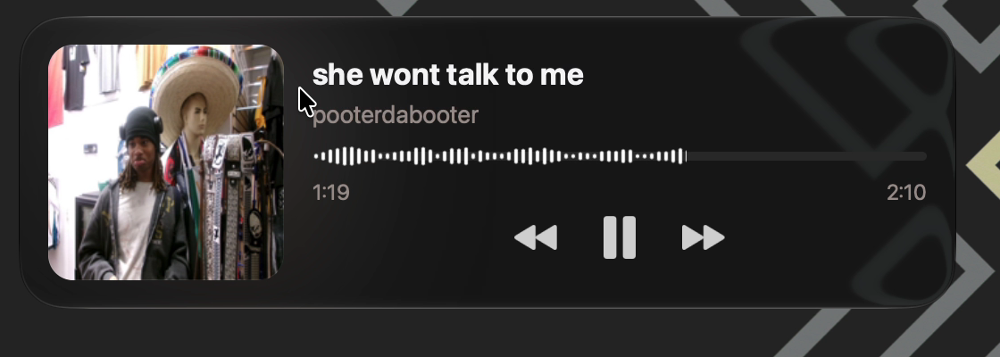

# Wallify

[](https://github.com/n0thhhing/wallify/actions/workflows/ci.yml)

A native macOS music widget written in Swift, with AppKit controls, SwiftUI Settings, and a Metal renderer. Displays live track metadata, album art, playback controls, synced lyrics, an animated aurora background, and idle companion sprites. With a Spotify account connected it adds a like button and Up Next. No terminal needed to run the built app.

[Wallify website](https://n0thhhing.github.io/wallify/)

## Previews

Native macOS screen captures from the app, cropped from the October 5 recording.

**Playback with artwork, controls, and live waveform**



**Animated raccoon companion**


## Install

Download the latest `Wallify-<version>.dmg` from [Releases](https://github.com/n0thhhing/wallify/releases/latest) and drag Wallify to Applications. Releases are built by GitHub Actions and are not notarized yet, so the first time, right-click Wallify and choose **Open**. A short setup screen then asks for the permissions Wallify uses. Requires macOS 12 or later on Apple silicon.

The rolling [nightly](https://github.com/n0thhhing/wallify/releases/tag/nightly) pre-release is rebuilt on every push to `main` or `combine`. To build from source instead, see [Run](#run).

## Features

- **Native glass** — `NSGlassEffectView` on macOS 26 and later, matching macOS desktop widgets; earlier systems use Wallify's own material
- **Media sources** — System Now Playing, Spotify (AppleScript), Spotifast (fast local IPC), or **Auto** (pings Spotifast, falls back to Now Playing automatically)
- **Media key redirect** — intercepts F7/F8/F9 via `CGEventTap` and routes them to your chosen source instead of waking Apple Music (requires Accessibility permission)
- **Artwork transitions** — Smooth Crossfade, Cinematic, Liquid Ripple, 3D Card Flip, Vinyl Spin, Cyber Glitch (Metal shader animations)
- **Idle companions** — Pixel Cat, Banana Cat, Raccoon, or Spotify button when nothing is playing
- **Stopped-music behavior** — show a companion, retain the last track, or hide; paused tracks stay visible
- **Desktop placement** — lock against accidental dragging and remember placement separately for each display
- **Optional clickable names** — open tracks and artist searches from the widget
- **Five widget form factors** — 1×1, 2×1, 3×1, 1×2, and 2×2 with animated resizing
- **Aurora background** — multi-stop gradient shifting to album art dominant colors
- **Power-aware renderer** — static artwork/glow is cached, animation runs in tiered frame budgets, and fully occluded widgets put the render loop to sleep
- **Synced lyrics** — optional current line under the progress bar, from lrclib.net, with a rise-and-fade transition between lines
- **Spotify account** — connect your own Spotify developer app to get a like button (with a pop and burst animation) and Up Next in the 2×2 size
- **Scroll actions** — scroll over the widget to change the Mac's output volume or seek
- **VoiceOver** — track details, playback buttons, a seekable progress slider, the like button and lyrics are accessible
- **Update checks** — daily check of GitHub releases on the Stable or Nightly channel; nothing downloads automatically
- **First-run setup** — a short screen requests Spotify control and explains audio capture and the optional account
- **Configurable** — hide text, hide progress bar, font scale, glow intensity, animation speed, glass border strength

## Run

**Requirements:** Swift (via Xcode), Clang, and the Xcode Metal toolchain (`xcrun metal` / `xcrun metallib`). Metal-capable Mac required.

```sh
./run                    # Build ReleaseFast, package, and launch Wallify.app
./run -f                 # Foreground — stream logs to terminal
./run --cli              # Display in a compatible terminal; drag to move within it
./run -d                 # Debug build with runtime assertions
./run -t                 # Run test suite before launching
./run -k                 # Stop running instance
./run -c                 # Clean before building
./run -R                 # Build, package, and restart through the LaunchAgent
./run -w                 # Rebuild and restart when source/build inputs change
./run -h                 # Show all options
```

After building, open `build/Wallify.app` from Finder, or run `./run --install` to replace `/Applications/Wallify.app`. Drag to move, and use the on-screen buttons and seek bar to control playback. The menu bar item (three bars) and the widget's right-click menu share one layout: playback, Widget Size, Media Source, Companion, Quick Preferences, Lock Position, then Open Spotify, Settings… and Quit. The menu bar menu also opens with the current track; clicking it opens the player. Save to Liked Songs and Update Available appear when they apply. Detailed effects and animation controls live in Settings. After rebuilding, quit and reopen the app to load the new interface; an already running instance keeps its previous code.

Enable **Clickable Names** in **Settings → Playback → Visibility** to open a track's Spotify page or search for its artist in your browser. This option is off by default; disabled names remain draggable. Spotify provides exact track links; Spotifast and other Now Playing sources fall back to a title-and-artist search. The links also work in terminal mode. Hovering underlines the name; desktop users can focus the widget, press Tab or Shift-Tab to choose a label, then Return or Space to open it. VoiceOver exposes both names as links, and plain text when the option is off. Hidden text and idle placeholders stay inactive.

**Lock Position** in **Settings → Desktop → Position** (or directly in either menu) prevents dragging and changing the widget size while keeping playback controls usable. Use the **Display** picker in the same Position section to choose a monitor. Wallify remembers a separate placement for each display in `display-placements.json` beside your settings file, restores the selected display at startup, and returns to it after reconnection. A disconnected monitor falls back to the primary display. Positions are kept within the display's usable area, including after a resolution or widget-size change. Terminal movement stays separate from desktop placement.

Choose **When Music Stops** under **Settings → General → Idle Behavior**: show the companion, keep the last track, or hide the widget. Pausing keeps the track visible. Hidden widgets return when a track becomes available; the menu-bar Settings remain accessible. The most recent track is retained for the current session, so switching from companion to Keep Last Track after music stops still works. See the [Settings guide](docs/settings.md) for page locations, disabled controls, and reset behavior.

Terminal mode uses the Kitty graphics protocol and SGR mouse reporting in any terminal that supports them, following the terminal support on `main` (`2e3f389`). Startup queries protocol support directly and waits up to two seconds for a positive reply; unsupported or unresponsive terminals exit with an explanation. It does not restrict startup by terminal name. The query follows the [protocol specification](https://sw.kovidgoyal.net/kitty/graphics-protocol/#querying-support-and-available-transmission-mediums). It shares the Swift renderer, media sources, waveform transitions, companions, and saved preferences. Drag the card to move within the terminal without snapping; click playback buttons or the seek bar as usual. Space toggles playback, left/right arrows (or `p`/`n`) change tracks, `1`–`5` change form factor, `m` cycles media sources, `s` opens Settings, and `q` or Ctrl+C exits. Terminal glass uses the rendered background. Desktop position is preserved, and CLI launch leaves the desktop instance running. Logs go to `/tmp/wallify-cli.log`. Inside tmux, enable `allow-passthrough` for graphics.

## Python sprite tools

The optional sprite tools require Pillow:

```sh
/usr/bin/python3 -m pip install --user -r requirements-dev.txt
```

Zed/basedpyright and VS Code use `/usr/bin/python3`. Run sprite scripts with that interpreter; no virtual environment is required.

## Configuration

The optional **System Audio Waveform** in Settings → Playback → Progress replaces the elapsed progress fill with live audio; the remaining track stays plain. It is off by default, requires macOS 14.2+ and system audio capture permission, and saves no audio. Capture stops when playback pauses, the widget is hidden, or progress/animations are disabled. The normal fill returns when audio is unavailable.

**Synced Lyrics** (Settings → Playback → Text, off by default) shows the current line under the progress bar in place of the time labels while a song has synced lyrics. Each new song's title, artist and length are sent to lrclib.net. **Scroll Action** (Settings → Playback → Scrolling) makes scrolling over the widget change the Mac's output volume, shown briefly on the progress bar, or seek.

**Spotify Account** (Settings → General) needs your own Spotify developer app: paste its client ID and add `http://127.0.0.1:43219/callback` as a redirect URI in the app's Spotify dashboard. Wallify logs in with PKCE, keeps the refresh token in your Keychain, and uses the account only for the like button and Up Next. **Updates** (Settings → Advanced) checks GitHub once a day on the Stable or Nightly channel; Nightly compares build commits.

Settings are saved to `widget-settings.conf`. The app checks these locations in order:

1. **`~/.config/Wallify/widget-settings.conf`** — XDG path; use for dotfiles or symlinks
2. **`~/Library/Application Support/Wallify/widget-settings.conf`** — macOS default; seeded from bundle on first launch

Rebuilding never overwrites saved preferences. Bare-binary development runs fall back to `./widget-settings.conf` in the working directory.

### Settings reference

```ini
[Appearance]
artwork_glow        = true          # Ambient glow from album art colors
native_glass        = false         # macOS glass (NSGlassEffectView on macOS 26+)
aurora              = true          # Animated multi-stop color gradient
animations          = true          # Spring-physics UI animations
dim_paused_artwork  = true          # Dim art when paused
frame_strength      = subtle        # off | subtle | strong
glow_intensity      = normal        # low | normal | high
animation_speed     = normal        # slow | normal | fast

[Behavior]
widget_mode         = expanded      # compact | two_by_one | expanded | one_by_two | two_by_two
media_source        = auto          # now_playing | spotify | spotifast | auto
idle_style          = cat           # cat | banana_cat | raccoon | spotify
track_transition    = cinematic     # default | cinematic | ripple | flip | vinyl | glitch
hide_text           = false         # Hide track title and artist labels
clickable_names     = false         # Enable track links and artist searches
lyrics              = false         # Synced lyrics from lrclib.net
scroll_action       = off           # off | volume | seek
position_locked     = false         # Prevent accidental dragging
stopped_behavior    = companion     # companion | keep_last_track | hide
hide_progress       = false         # Hide the progress/seek bar
font_scale          = normal        # small | normal | large
media_key_target    = off           # off | active | spotify | spotifast
show_controls       = true          # Show playback buttons
show_timestamps     = true          # Show time labels
waveform            = false         # Optional system audio capture
artwork_border      = true
compact_gradient    = true
artwork_radius      = 1             # 0: soft | 1: rounded | 2: large
progress_thickness  = 1             # 0: thin | 1: standard | 2: thick

[Updates]
check_updates       = true          # Daily GitHub release check
update_channel      = stable        # stable | nightly

[Position]
widget_margin_left  = 8
widget_margin_top   = 8
widget_grid_x       = 0
widget_grid_y       = 0

[Debug]
widget_debug        = false         # Show snapping diagnostics HUD
```

## Develop

```sh
./scripts/build.sh -O ReleaseFast
./scripts/build.sh -O Debug --test
./scripts/build.sh -O Debug --debug-inspector
bash scripts/package-app.sh
```

Build output lives under `build/variants/<mode>[-Inspector]-<architecture>/`.
Debug, ReleaseFast, and Inspector builds keep separate binaries, resources,
and incremental objects. `build/current` selects the last successful build;
`build/bin`, `build/lib`, and `build/resources` remain compatibility links.
Failed compilation or tests do not select a new configuration. Use ReleaseFast
for performance measurements; Debug retains runtime assertions.

Every build also writes an ignored `compile_commands.json` at the repository
root. SourceKit-LSP uses it to see the complete Swift targets and the C bridging
header defining types such as `DrawCommand`. Native entries also give clangd
the C++17, SDK, ARC, and ImGui include settings for the Inspector and the
checked-in ImGui snapshot, even on builds without the Inspector. Run
`./scripts/build.sh -O Debug --debug-inspector` once in a fresh checkout to
fetch the pinned ImGui headers and backends. Open the repository folder in your
editor, run the build once, and restart its language servers if existing
diagnostics persist. Zed's Debug and Profile configurations use the same build
script and `build/bin/wallify` executable.

Builds skip unchanged targets and reuse Swift's incremental dependency graph when sources change. Source contents, headers, compiler options, and the selected toolchain invalidate the relevant outputs. Switching configurations preserves their caches. `--test` always runs the checks, even when the test binary is already current. Delete `build/` for a clean rebuild.

Packaging signs with an available Developer ID or Apple Development identity, so Keychain and privacy approvals survive rebuilds; set `WALLIFY_SIGN_IDENTITY` to choose one, and machines without an identity sign ad hoc.

Packaging uses the selected configuration; `scripts/package-app.sh -O ReleaseFast`
or `-O Debug` explicitly builds and selects one (Debug packaging includes the
Inspector). Unchanged package inputs and an intact bundle skip copying and
signing. Changed inputs are copied into a temporary bundle, signed, verified,
then published with a native atomic swap. Failures before publication leave the
previous app intact. A changed or incomplete bundle invalidates the package cache.

Watch mode scans `src`, `assets`, `config`, `scripts`, `tests`, and `run`, using
nanosecond modification times and file sizes. Docs, build output, editor files,
and logs do not trigger rebuilds. Build logs, startup logs, Settings → Advanced
→ Diagnostics, and the Inspector show configuration, architecture,
commit, modified-worktree status, and whether the Inspector is included. This
identity is also packaged as `Contents/Resources/build-info.json`. Restart the
app to compare its running identity with the latest build.

Set `WALLIFY_PROFILE=1` to enable scene-preparation timing, GPU frame timing, texture upload counters, and periodic renderer statistics. Native lifecycle logs also report cache rebuilds, texture uploads/swaps, resize requests, and visibility changes.

Debug builds can enable the Dear ImGui Inspector with `--debug-inspector`. Open it from **Settings → Advanced → Diagnostics**. It includes Widget, Renderer, Performance, Input, Layout, and Console / Events tabs. Widget controls include clickable names, waveform, companions, stopped-music behavior, and position locking. Media readouts distinguish paused and stopped playback and report hiding caused by stop behavior. Layout shows the current display and placement margins. The Performance tab exposes scheduler tier, occlusion state, static-scene cache status and rebuilds, renderer timing, draw-call averages, and texture memory. Inspector setting edits use the same persisted settings bridge as Settings.

### Releases

The version lives in `VERSION`. `./scripts/release.sh 1.1.0` requires a clean tree and a newer version, runs the tests, bumps `VERSION`, commits, tags `v1.1.0` and pushes. The **Release** workflow then checks the tag matches `VERSION`, builds, tests and publishes the GitHub release with its DMG. The **Nightly** workflow replaces the `nightly` pre-release on every push to `main` or `combine`, and **CI** builds and tests every push. All three run on GitHub's `macos-26` runners and install the Metal toolchain first.

The website in `docs/` (`index.html`, `style.css`, `site.js`) is published by GitHub Pages from `main`. Its interactive preview copies the layout table from `src/ui/layout.swift`, so update both together.

### Performance model

Wallify deliberately does not redraw at the display refresh rate all the time. Input-critical motion such as dragging, snapping, and widget resizing can run at 60 FPS; short decorative transitions use 30 FPS; ambient effects use 20 FPS. During playback the progress bar redraws only when it gains a pixel (a few times a second), at least once a second with time labels, and at 20 FPS while the live waveform shows. Synced lyrics wake exactly when the next line starts. The active player is split into a cached static layer and a small dynamic layer so artwork, glow, controls, and the frame do not get shaded again on every playback tick.

Spotify updates come from its playback notifications; AppleScript runs once per new track and as a check every 15 seconds while visible (30 seconds while covered), because Spotify posts nothing for seeks.

When macOS reports the widget as fully occluded, Wallify keeps the latest scene marked dirty but stops waking the animation loop and issuing Metal work. Visibility changes wake the loop once so the next frame incorporates any metadata or settings changes that arrived while covered.

## Architecture

See [`docs/architecture.md`](docs/architecture.md) for a breakdown of the rendering pipeline, media source multiplexer, settings bridge, and native glass implementation.

## License

Wallify is released under the [MIT License](LICENSE).
